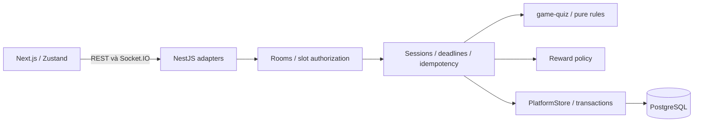

# Kiến trúc

Monorepo quản lý source; NestJS Modular Monolith là tổ chức runtime. Một API instance, một PostgreSQL. Game packages là thư viện nội bộ được bundle vào API.

`shared-types` là public wire contract. `game-sdk` mô tả interface engine phía server; `game-core` chỉ chứa cơ chế dùng chung có nhu cầu thật. Web không import game engine, Prisma hay Nest; lint kiểm soát ranh giới này. Engine không import Nest, Prisma, React hoặc Socket.IO.

Frontend feature Quiz tách `quiz-client` (identity/transport/commands), `quiz-setup` (mode/layout/lobby setup) và `quiz-stage` (lobby/board/result rendering). Zustand chỉ giữ public view cho giao diện; không chuyển engine sang client. UI skin nền tảng dùng design tokens CSS và primitives trong `packages/ui`.

`RoomsService` sở hữu controller/slot/Ready/votes và hàng xử lý mỗi room. `SessionsService` sở hữu deadline, action receipts, snapshot của engine và kết toán. `GameGateway` chỉ auth, validation, ACK, rate limit và chuyển tiếp. View được lọc cho từng socket; không broadcast raw state.

State trận đang chạy trong RAM. Database giữ guest, pack versions, session snapshot, answers, result và kinh tế. Không có tự động resume process sau crash; startup hủy session `IN_PROGRESS` cũ. Tách interface store không đồng nghĩa đã giải quyết multi-instance.

Prisma 6.19 được pin để sử dụng generator/datasource đã kiểm tra. Các framework khác được khóa bằng `pnpm-lock.yaml`. Nâng major phải cập nhật config, kiểm thử và migration. DI Nest dùng `@Inject(...)` rõ ràng để dev/build cùng hoạt động khi transpile bằng esbuild, không phụ thuộc metadata tự suy diễn.

Tham khảo: [Next transpilePackages](https://nextjs.org/docs/pages/api-reference/config/next-config-js/transpilePackages), [Prisma 6 schema](https://www.prisma.io/docs/orm/v6/prisma-schema/overview/data-sources), [Socket.IO delivery](https://socket.io/docs/v4/delivery-guarantees/).
