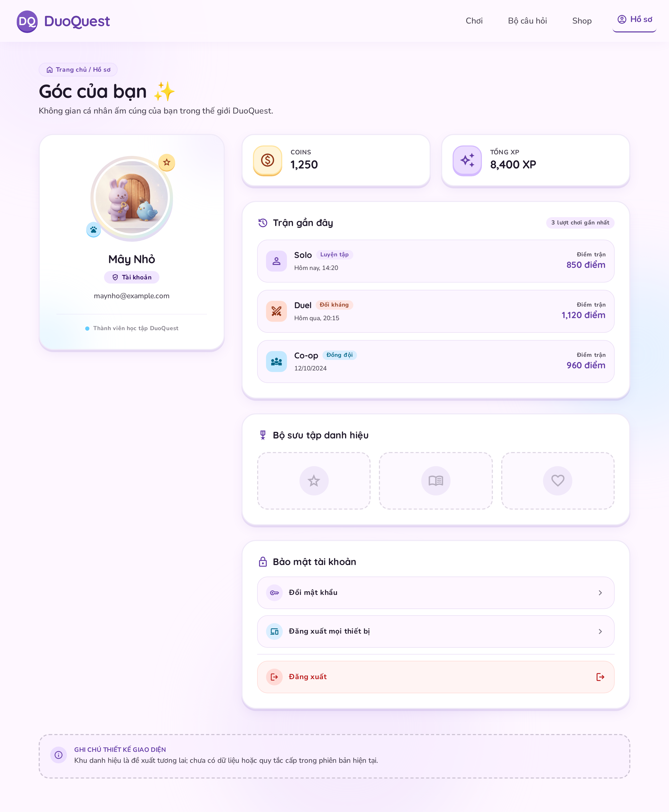

# Tài khoản — brief Stitch desktop

> **Mục đích:** Prompt thiết kế trang hồ sơ tài khoản, bằng chứng kiểm tra Stitch và đối chiếu tích hợp web/API.
> **Đối tượng:** Chủ dự án, người thiết kế và lập trình viên frontend/backend.
> **Trạng thái:** `current`.
> **Cập nhật:** 2026-11-08 (tích hợp giao diện Pastel Lavender 1 cột vào `/profile` và ghi chú danh mục mở rộng API).
> **Liên quan:** [Mục lục](../../README.md), [Auth](../../features/auth.md), [Kinh tế và vật phẩm](../../features/economy-items.md), [Quyết định](../../architecture/decisions.md), [Auth Mini](../auth/minimal-auth.md).

## Phạm vi

Một màn desktop web để review, chưa triển khai giao diện hoặc backend. Dùng project [DuoQuest Cozy Game Lobby](https://stitch.withgoogle.com/projects/9329491706796553468), ID `9329491706796553468`, và design system Pastel Playfield `assets/5ec9ef8fabdd43a58b9ba2c5bb4950c7`. Giữ nguyên các màn auth; chưa thiết kế mobile.

Avatar linh vật mặc định có khung trang trí; nickname, nhãn tài khoản và email giả nằm bên dưới. Coins và tổng XP độc lập với điểm từng trận. Lịch sử chỉ trình bày mode, ngày và điểm trận; khu bảo mật có đổi mật khẩu, đăng xuất và đăng xuất mọi thiết bị.

Danh hiệu là concept tương lai, chưa có dữ liệu, quy tắc cấp hoặc quyền sở hữu. Rank, cấp độ và ngưỡng XP không thuộc thiết kế này. Avatar không có chức năng upload/chỉnh sửa. Giá trị mẫu chỉ phục vụ bố cục, không chứng minh tài khoản hoặc phần thưởng thật.

## Prompt đã gửi qua MCP

```text
Create exactly ONE new desktop web screen named
“Account — 01 Hồ sơ người chơi — Pastel Concept”
inside the existing DuoQuest project.

Do not modify existing screens. Desktop web only.
This is a visual design for review, not production implementation.

PRODUCT
DuoQuest is a learning-and-playing web game hub.
V1 focuses on Quiz Battle with Solo, Duel and Co-op.
Design a personal account/profile page, not a login screen.
All visible interface copy must be Vietnamese.

STYLE REFERENCE
Reuse the existing Pastel Playfield design language and the
Auth Mini polished screens, especially screen
e71c331ea7d540dba530d0f04744b70b.

Use Quicksand headings and Nunito Sans body.
Palette: lavender #7E57C2, deep purple #653DA7,
sky blue #4FC3F7, peach #FFCEB8, butter yellow #FFE49E,
cream-lavender background #FEF7FF, dark text #2D2638.

Make it feel like a lively, cozy game character profile:
soft clay 3D illustrations, rounded collectible stickers,
puffy cards, subtle colored shadows, tactile buttons.
Maintain clear hierarchy and generous whitespace.
Decorations should support the content without covering it.

LAYOUT
Desktop artboard width 1440px, content max-width 1180px.
Allow natural vertical scrolling.

Top: compact DuoQuest navigation with Chơi, Bộ câu hỏi,
Shop and Hồ sơ. Highlight Hồ sơ.
Page heading: “Góc của bạn”.

Below: a two-column composition.
Left column about 340px: a distinctive player identity card.
Right column: progression, recent matches and account security.

IDENTITY CARD — MAIN VISUAL FOCUS
Place a large circular avatar, approximately 150px,
inside a thick layered pastel frame.
Use a cute lavender clay bunny as the default avatar.
Add a small sky-blue bird and a few decorative stars nearby.

Directly BELOW the avatar, vertically centered:
- Fictional nickname “Mây Nhỏ”.
- Small “Tài khoản” badge.
- Fictional email “maynho@example.com”.

The avatar frame is decorative, not evidence of an owned item.
No upload, camera, edit-avatar or edit-nickname button.
Do not add age, gender, location, bio or public contact links.

PROGRESSION
Two attractive, distinct compact cards:
- “Coins” with a clay coin icon.
- “Tổng XP” with a star icon.

Use sample values for visual composition only.
Do not add level numbers, XP thresholds, rank, leaderboard,
daily streaks, win rates or lifetime match totals.
Coins, XP and individual match score are different concepts.

RECENT MATCHES
Heading: “Trận gần đây”.
Show three compact rows with:
mode Solo / Duel / Co-op, date and “Điểm trận”.
Use clean readable numbers and playful mode icons.
Do not imply that match scores are wallet currency.
Do not add victory claims or unsupported rewards.

TITLES — FUTURE CONCEPT ONLY
Include a modest collectible shelf titled “Bộ sưu tập danh hiệu”.
Show three neutral, unearned badge silhouettes with
soft star, book and companion motifs.
Do not invent title names, unlock requirements, progress,
rarity, bonuses or ownership.

Place a clearly separate design annotation OUTSIDE the
product interface:
“Khu danh hiệu là đề xuất tương lai; chưa có dữ liệu
hoặc quy tắc cấp trong phiên bản hiện tại.”
Do not put developer notes inside the product UI.
Rank is excluded entirely.

ACCOUNT SECURITY
A quieter card titled “Bảo mật tài khoản”.
Show “Đổi mật khẩu”, “Đăng xuất mọi thiết bị”
and a visually separated “Đăng xuất” action.
Do not expose password fields in the default overview.
No delete-account, social sign-in, referral or subscription UI.

POLISH
Use 24–32px card radii, gentle gradients and small sticker accents.
Keep labels and numbers as real selectable text.
Ensure readable contrast, visible keyboard focus,
and click targets at least 44px.
If an HTML preview is produced, add subtle button press feedback
and a gentle entrance transition; honor prefers-reduced-motion.
Avoid continuously flashing decorations.

No friends, chat, guilds, new games or fake online counters.
Generate exactly this one desktop screen.
```

## Kiểm chứng và giới hạn

Ngày 2026-11-08: đã đọc resource, ảnh và HTML của bản đầu `01ffe354e6044174ba673146d25f7859`. Bố cục avatar/thông tin, Coins/XP, lịch sử và bảo mật đúng hướng. Stitch tự thêm tên danh hiệu, footer tiếng Anh, nút âm thanh/trợ giúp và trang trí hình mũi tên; đã gửi yêu cầu chỉnh riêng màn này. Resource đầu trả ảnh 2560 × 3446, khác artboard 1440px yêu cầu, dù HTML có container max-width 1180px. Lần đọc project ngay sau generation chưa thấy bản đầu trong screenInstances; chưa kết luận màn có trên canvas.

### Bản chỉnh để review

- Screen resource: `projects/9329491706796553468/screens/cc54b8c2f03c4c7ea9da95099785bfd8`.
- Tên Stitch trả về: **Hồ sơ người chơi — DuoQuest (Refined 1440px)**. Đây là bản chỉnh của cùng concept, không phải một luồng sản phẩm mới.
- Đã tải và xem screenshot, đọc HTML bằng `download_file`. Ảnh và HTML xác nhận tên danh hiệu tự đặt, footer tiếng Anh, nút âm thanh/trợ giúp và trang trí mũi tên đã được gỡ. Avatar/thông tin bên dưới, Coins, XP, ba mode và ba hành động bảo mật được giữ lại.
- Khu danh hiệu chỉ còn ba silhouette không có tên, quyền sở hữu, điều kiện hoặc thưởng. Ghi chú concept nằm dưới vùng nội dung chính, tách bằng khung nét đứt; trong HTML vẫn cùng phần tử `main`, chưa phải annotation độc lập trên canvas.
- HTML có font Quicksand/Nunito Sans, container `max-w-[1180px]`, quy tắc `prefers-reduced-motion`, navigation có `min-h-[44px]` và focus-visible, nút bảo mật có `min-h-[48px]`. Đây là kiểm tra source prototype, chưa nghiệm thu tương tác/a11y bằng browser.
- **Kích thước chưa khớp:** dù tên màn ghi 1440px và đã yêu cầu chỉnh, metadata/screenshot thực tế vẫn là **2560 × 3104**. Không coi tên màn hoặc mô tả tự động của Stitch là bằng chứng đạt artboard 1440px.
- **Canvas chưa xác nhận:** lần `get_project` sau chỉnh trả `updateTime=2026-11-08T09:22:31.244707Z` nhưng không có cả hai screen ID trong `screenInstances`; `list_screens` cũng không trả hai màn. `get_screen` vẫn đọc được bản đầu, và bản chỉnh có resource/ảnh/HTML. Chưa có bằng chứng bản chỉnh hiển thị trên canvas. Bộ MCP hiện có không cung cấp công cụ thêm resource có sẵn vào canvas; chưa xác định nguyên nhân.
- Các số liệu, nickname, email và ngày trận trong ảnh là mẫu hư cấu; ngày mẫu cũ trong lịch sử không phải lịch sử người dùng thật.



## Tích hợp Web `/profile` & Đối chiếu API/Schema (2026-11-08)

- **Screen tích hợp:** `projects/9329491706796553468/screens/10622428d26941bb9f0de8075091e2ab` và `projects/9329491706796553468/screens/cc54b8c2f03c4c7ea9da95099785bfd8` (**Hồ sơ người chơi — DuoQuest (Refined 1440px)**, bố cục 1 cột dọc `max-w-[960px]`, thẻ Hồ sơ nằm ngang ở trên cùng).
- **Source web đã triển khai:**
  - `apps/web/src/app/(main)/profile/page.tsx`
  - `apps/web/src/features/auth/account-settings.tsx`
  - `apps/web/src/features/profile/profile.utils.ts`
  - Ảnh đại diện mặc định cục bộ: `apps/web/public/images/profile/default-avatar.jpg` (tải từ HTML Stitch, định dạng JPEG `ffd8ffe0`, không phụ thuộc URL ngoài).
- **Quyết định UI sản phẩm:**
  - Giữ khu **Bộ sưu tập danh hiệu** (3 ô silhouette nét đứt) kèm nhãn `Sắp ra mắt`.
  - Ẩn khối `GHI CHÚ THIẾT KẾ GIAO DIỆN` khỏi giao diện người dùng cuối (đúng nguyên tắc không đưa developer annotation vào sản phẩm).
  - Hàng **Đổi mật khẩu** trong thẻ **Bảo mật tài khoản** mặc định thu gọn, chỉ mở biểu mẫu mật khẩu khi người dùng nhấn vào.

### 1. Dữ liệu đã kết nối trực tiếp từ API hiện có

| Khu vực giao diện | Trường dữ liệu                                                | Nguồn API hiện có                                                                      |
| ----------------- | ------------------------------------------------------------- | -------------------------------------------------------------------------------------- |
| Thẻ Hồ sơ         | `nickname`                                                    | `GET /api/players/me` → `nickname`                                                     |
| Thẻ Hồ sơ         | Loại hồ sơ (`Tài khoản` / `Khách`), `email`, `role`           | `GET /api/auth/me` → `kind`, `email`, `role`                                           |
| Chỉ số tích lũy   | `Coins`, `Tổng XP`                                            | `GET /api/players/me` → `wallet.balance`, `xp`                                         |
| Trận gần đây      | `mode` (`SOLO`/`DUEL`/`COOP`), `finishedAt`, `score`          | `GET /api/players/me/history` (tối đa 20 trận `FINISHED` gần nhất)                     |
| Bảo mật tài khoản | Đổi mật khẩu, Đăng xuất mọi thiết bị, Đăng xuất / Thoát guest | `POST /api/auth/password/change`, `POST /api/auth/logout-all`, `POST /api/auth/logout` |

### 2. Dữ liệu trên Stitch chưa có trong DB/Schema hoặc thiếu Field ở API (Ghi chú chờ thiết kế mở rộng API)

1. **Bộ sưu tập danh hiệu (`Titles / Badges`):**
   - _Hiện trạng:_ `prisma/schema.prisma` và `rest-schemas.ts` chưa có model danh hiệu (`TitleDefinition` / `PlayerTitle`), chưa có điều kiện mở khóa và chưa có trường danh hiệu trong `GET /api/players/me`.
   - _Hướng mở rộng API sau:_ Thiết kế bảng/model danh hiệu hoặc mở rộng `ItemDefinition` (`kind = 'TITLE'`), bổ sung trường `titles` vào response hồ sơ.
2. **Ảnh đại diện & Khung trang bị trên thẻ Hồ sơ (`Avatar & Equipped Frame`):**
   - _Hiện trạng:_ `Player` chưa có cột `avatarId`/`avatarUrl`. Bảng `Loadout` đã có trong DB (truy vấn qua `GET /api/shop/inventory`), nhưng `GET /api/players/me` (`PrismaStore.profile()`) hiện chỉ trả `{ id, nickname, xp, wallet: { balance } }`, chưa trả `loadout`.
   - _Hướng mở rộng API sau:_ Bổ sung `loadout` (và `avatarId` nếu cho phép đổi linh vật) vào `GET /api/players/me` (`profileResponseSchema`).
3. **Ngày tham gia (`Player.createdAt` / `Account.emailVerifiedAt`):**
   - _Hiện trạng:_ Cột `createdAt` đã có trong bảng `Player` nhưng chưa được select trong `PrismaStore.profile()` và `profileResponseSchema`.
   - _Hướng mở rộng API sau:_ Thêm `createdAt` vào `GET /api/players/me` khi cần hiển thị mốc thời gian tham gia.
4. **Tổng số trận hoàn tất & Phân trang lịch sử (`GET /api/players/me/history`):**
   - _Hiện trạng:_ `GET /api/players/me/history` trả mảng tối đa 20 trận `FINISHED` gần nhất (`take: 20`), chưa trả tổng số trận toàn thời gian (`totalFinishedMatches`) hoặc cursor phân trang.
   - _Hướng mở rộng API sau:_ Bổ sung tổng số trận hoặc hỗ trợ query `limit`/`cursor` khi mở rộng trang lịch sử chi tiết.

## Prompt tinh chỉnh

```text
Refine ONLY selected account screen; preserve its two-column pastel layout, avatar, identity, Coins, XP, match history, security. Do not modify other screens or create additional concepts.
Correct these deviations:
1. Remove invented title names “Ngôi sao mềm”, “Sách ma thuật”, “Đôi bạn đồng hành” and all “Vị trí dự kiến”, “Đang hoàn thiện” texts from the title collection. Keep ONLY three subdued unnamed silhouette icons (star, book, companions) with no text underneath, no acquired/rarity/requirements/progress. Preserve heading “Bộ sưu tập danh hiệu”.
2. Remove the entire invented footer, including 2024 studio attribution and English legal/help/status links. No footer is needed.
3. Remove sound and help buttons in top nav; retain logo and Chơi/Bộ câu hỏi/Shop/Hồ sơ.
4. Remove the floating arrow_back_ios_new decoration and animate-pulse. Use static small stars if needed.
5. Retain the separate outside-product design annotation exactly “Khu danh hiệu là đề xuất tương lai; chưa có dữ liệu hoặc quy tắc cấp trong phiên bản hiện tại.” Place it visually outside the product canvas, after the main product region.
6. Set DESKTOP artboard to 1440px CSS width and container max-width 1180px. Current screen metadata says 2560px; please produce 1440px desktop artboard if possible. No mobile artboard.
7. Header navigation touch/click targets >=44px height and visible keyboard focus. Keep Nunito Sans body, Quicksand headings, reduced-motion support. Do not invent any additional feature or fake functionality.
```
